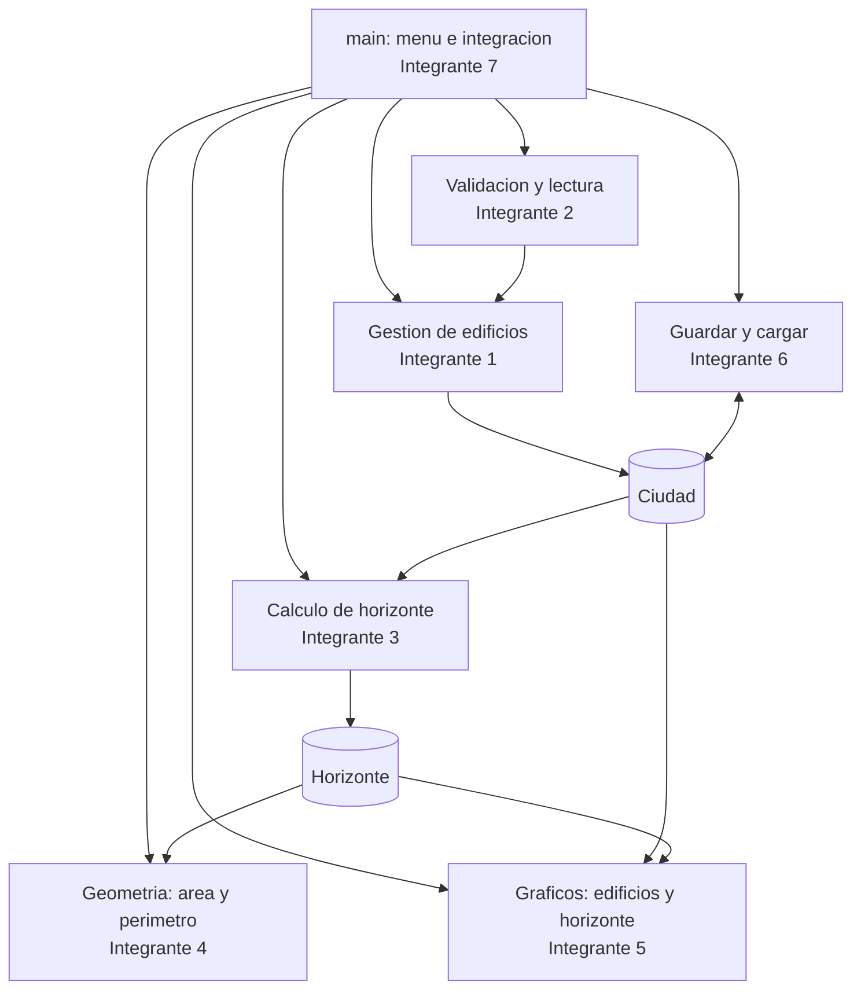
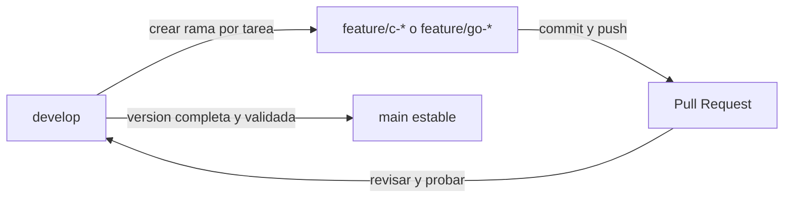

# Arquitectura modular del programa

GitHub puede representar automáticamente este diagrama Mermaid.

## Flujo en GitHub

**Nota:** `main` nunca se edita directamente. Los integrantes deben crear ramas DESDE `develop`,
abrir PR a `develop` y reservar los PR `develop -> main` para entregas integradas.
